# Solutions

One file per question. Each one gives the main solution first, then the further optimizations, and shows every version's results side by side.

| Question | Target | Baseline (avg) | Main solution | Further optimizations | **Graded (avg)** | Write-up |
|---|---:|---:|---|---|---:|---|
| **Q1**: one LLM call per ticket | ≤ 3,000 | 8,878 | **v1**: remove the wordy instructions, trim the input → 1,584 | **v2**: rule table, lean user message → 1,235; **v3**: rules in field names → 1,163 | **1,163** (v3, −87%) | [Q1.md](Q1.md) |
| **Q2**: four-node pipeline | ≤ 2,500 | 73,415 | **v1**: one LLM call; triage, retrieve and audit as code → 1,460 | **v2**: Markdown stripped, shorter instruction → 1,376 | **1,376** (v2, −98.1%) | [Q2.md](Q2.md) |

Every version gives the correct `action` and `kb_article` on all public tickets and on the holdout T-1091. All 23 tests pass.

## Slides

The submission deck ([Intern_Assignment_Submission.pptx](../Intern_Assignment_Submission.pptx)), one image per slide.

### Problem statements

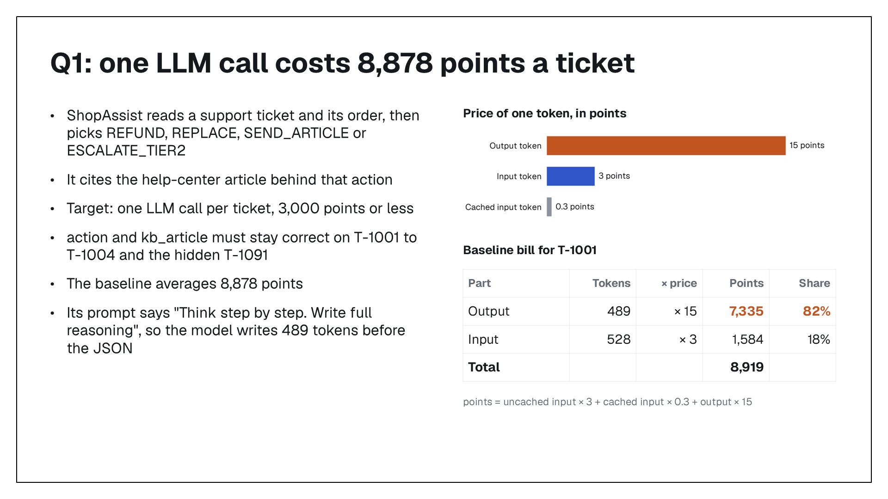
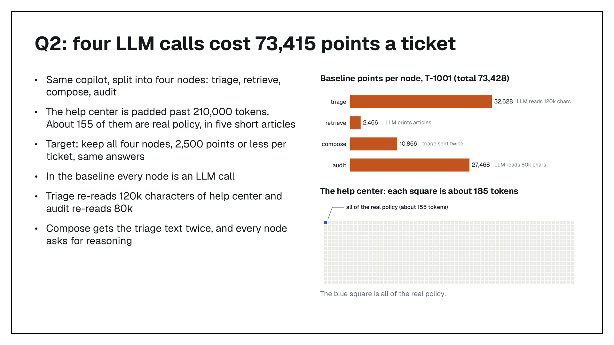

### Approach

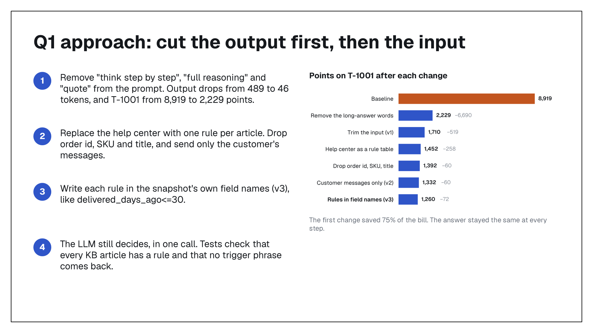
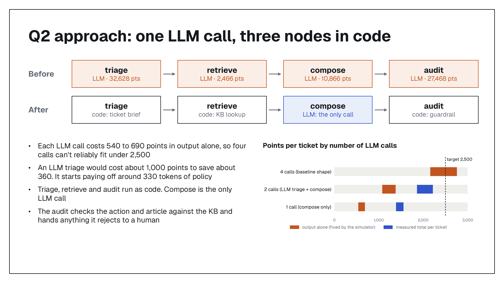

### Implementation

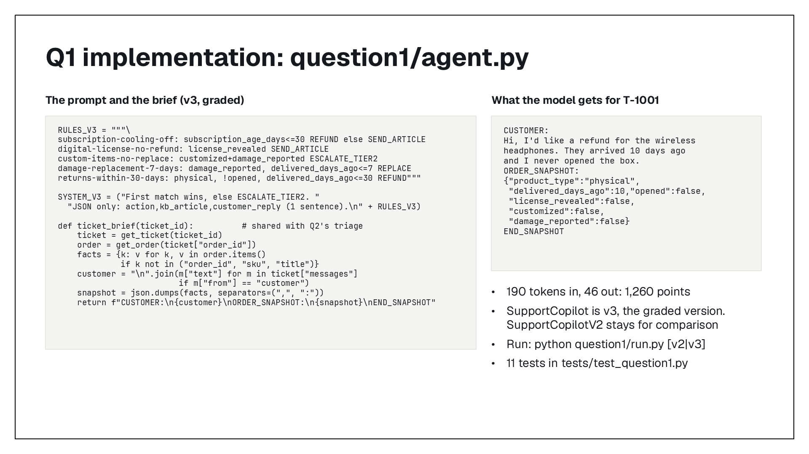
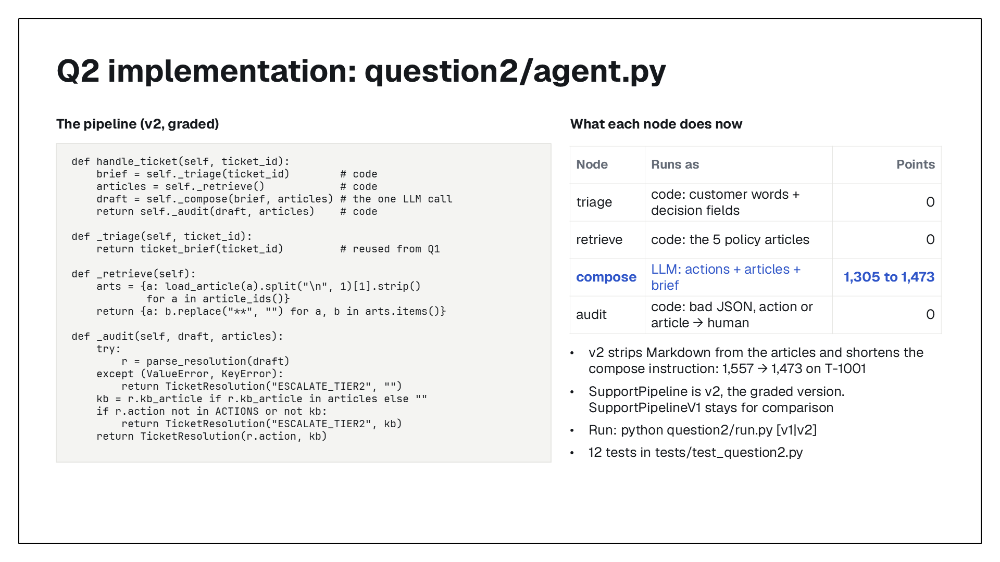

### Results

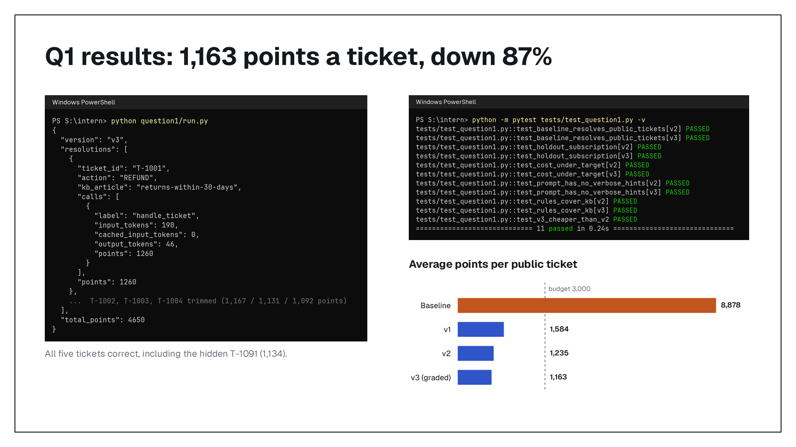
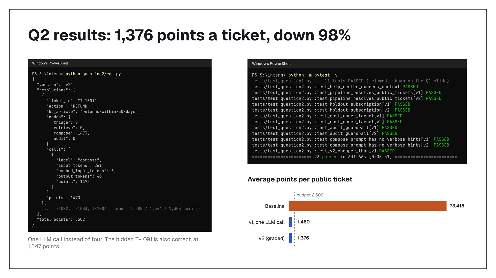

### Summary

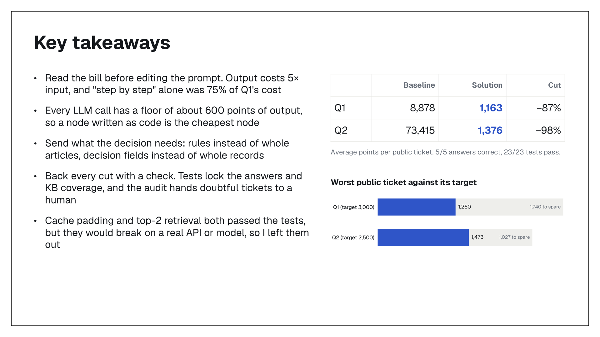
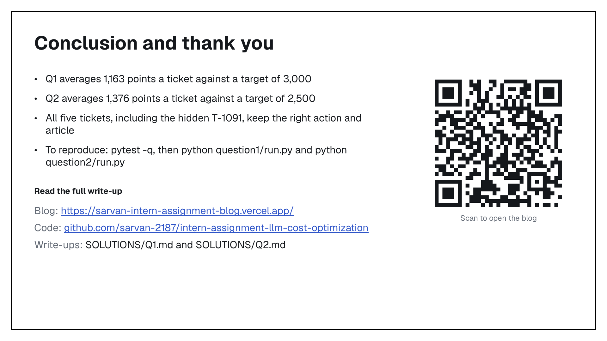

<details>
<summary>Title and agenda</summary>

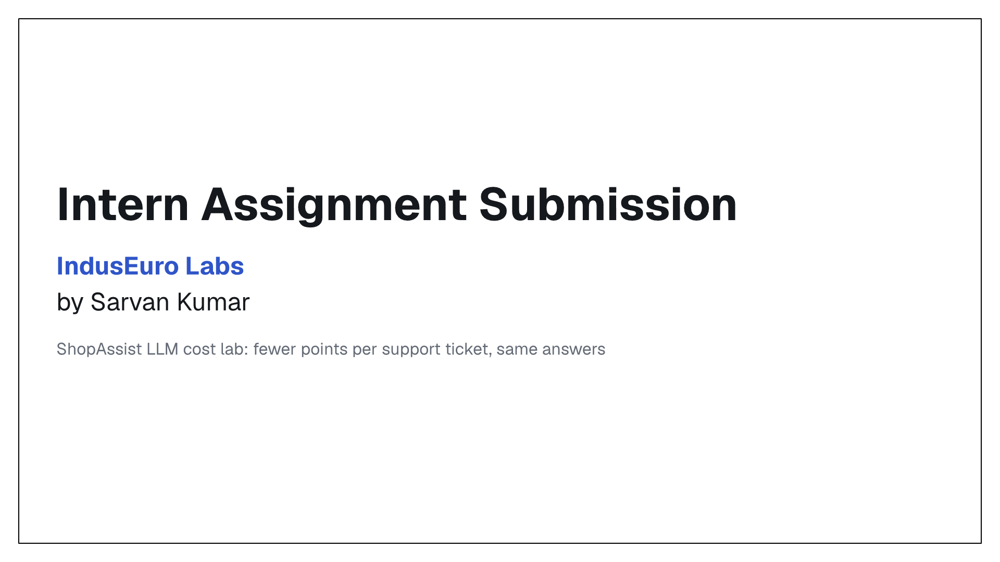
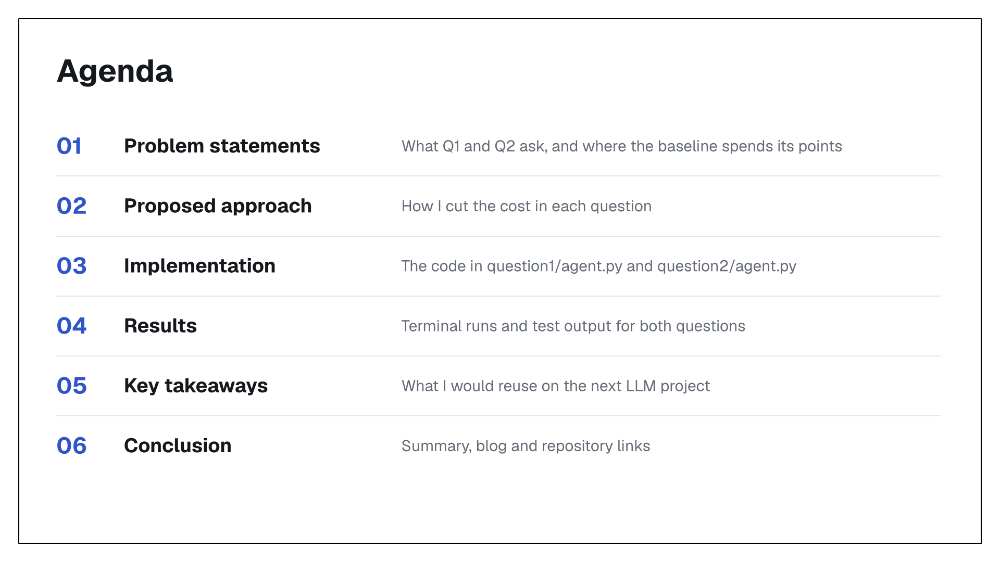

</details>

## Run

```bash
pip install -r requirements.txt
pytest -q tests/                    # 23 tests (the Q2 help-center size test takes minutes)
python question1/run.py             # Q1 v3 (graded)  — or: python question1/run.py v2
python question2/run.py             # Q2 v2 (graded)  — or: python question2/run.py v1
```
